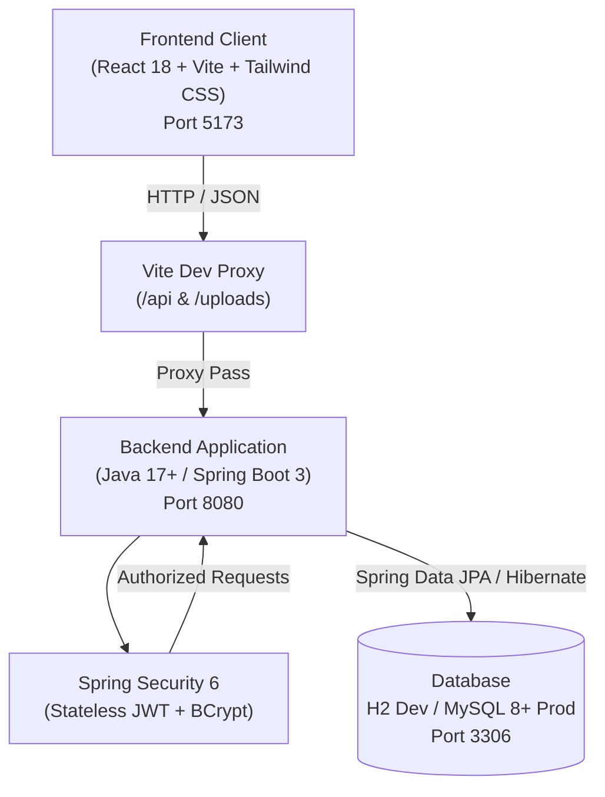

# CrisisConnect — Architecture & System Design

CrisisConnect is a full-stack, enterprise-grade emergency response and incident coordination system specifically configured for campus environments (SRM Institute of Science and Technology, Kattankulathur).

---

## 1. High-Level System Architecture

---

## 2. Core Architectural Subsystems

### A. Frontend Layer (`client/`)
- **Technology:** React 18, standard JavaScript (`.jsx` / `.js`), Vite 5, Tailwind CSS 4.
- **Client Routing:** `react-router-dom` v6 with declarative route definitions in `App.jsx`.
- **Role Isolation:** Protected routes guarded by `ProtectedRoute.jsx` and `AuthContext.jsx`.
- **State Management:** React Context API for authentication state and local hook-based state management (`useState`, `useEffect`) for individual page lifecycles.
- **Network Interception:** Axios instance configured in `src/services/api.js` automatically injects `Authorization: Bearer <token>` and intercepts 401 Unauthorized responses to perform clean session termination.

### B. Backend Application Layer (`server/`)
- **Technology:** Spring Boot 3.2.5+ running on Java 17+.
- **Architectural Pattern:** Layered Architecture:
  - **Controllers (`controller/`):** REST endpoints handling HTTP request routing, path variables, query parameters, and validation.
  - **Services (`service/`):** Business logic, authorization boundaries, entity transactions, status transition rules, and audit logging.
  - **Repositories (`repository/`):** Spring Data JPA repositories with custom derived and JPQL queries.
  - **Entities (`entity/`):** JPA Object-Relational Mappings (ORM) representing database tables and foreign key constraints.
  - **Security (`security/`):** Spring Security filter chain with custom `JwtAuthenticationFilter` verifying HMAC-SHA signed JWT tokens.

### C. Data Persistence Layer (`database/`)
- **Dual-Engine Strategy:**
  - **In-Memory H2:** Used under the `dev` profile for instant zero-configuration development with automatic schema generation and data seeding.
  - **Production MySQL:** Used under the `prod` profile with Flyway version-controlled migrations (`db/migration/V1__initial_schema.sql`).

---

## 3. Security Architecture & Threat Model

1. **Stateless Authentication:** User credentials (`username` and `password`) are authenticated against BCrypt-hashed passwords in the database. Upon verification, a stateless JWT is issued containing user ID, role, and expiration claims.
2. **Role-Based Access Control (RBAC):**
   - **Public:** Incident reporting (`POST /api/public/crises`), status tracking (`GET /api/public/crises/track/{id}`), category listing (`GET /api/categories`), and system telemetry (`GET /api/public/status`).
   - **`ADMIN`:** Full access to EOC management (`/api/admin/**`), incident triage, responder allocation, and roster monitoring.
   - **`RESPONDER`:** Restricted access to personal assignments (`/api/responder/**`), on-scene arrival marking, progress notes, and resolution reports.
3. **Data Integrity & Audit:**
   - Every incident status change is recorded as an immutable row in `crisis_status_history`.
   - Critical system interactions generate regulatory records in `audit_logs` tracking actor, action, target entity, IP address, and timestamp.
